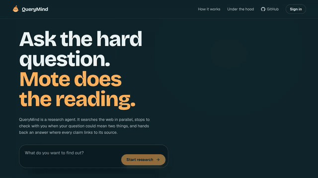
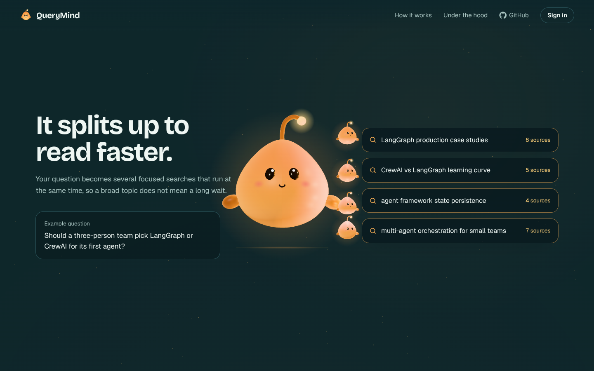
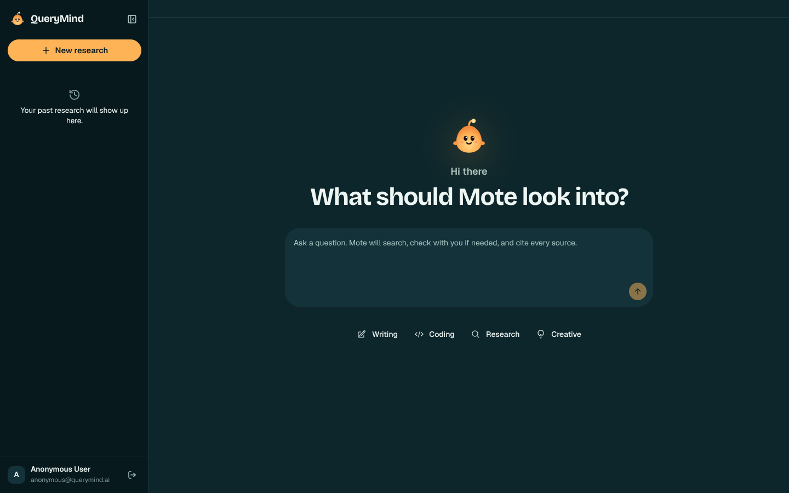
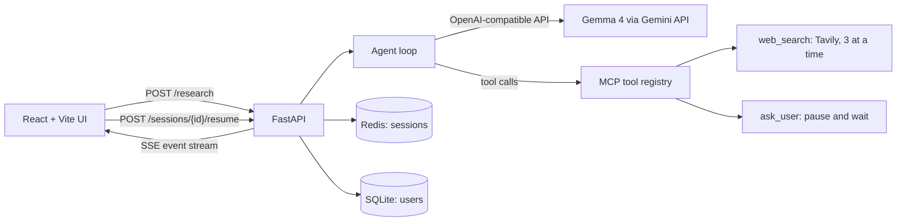

<p align="center">
  
</p>

<h1 align="center">QueryMind</h1>

<p align="center">
  An AI research agent that searches the web in parallel, asks clarifying questions when it needs to, and answers with cited sources.
</p>

<p align="center">
  <a href="docs/media/querymind-tour.mp4">
    
  </a>
  <br />
  <sub><a href="docs/media/querymind-tour.mp4">Watch the full 43-second tour (MP4)</a></sub>
</p>

---

## What it does

You ask a question. QueryMind's agent breaks it into several focused web searches and runs them at the same time. If your question could mean two different things, the agent stops and asks you which you meant, then carries on from where it paused. The answer streams back as it is written, with every claim numbered and linked to the source it came from.

| Landing page | Research app |
|---|---|
|  |  |

### Features

- **Parallel web search.** The model can request several searches in one step; they run concurrently through `asyncio.gather`, throttled by an `asyncio.Semaphore(3)` and a small random delay so the Tavily API is not hammered.
- **Human in the loop.** An `ask_user` tool lets the model pause the run. The backend parks the agent on an `asyncio.Event`, streams a `pause` event to the browser, and wakes up when the answer arrives at `POST /sessions/{id}/resume`.
- **Streaming over Server-Sent Events.** `POST /research` returns a `text/event-stream` of `searching`, `source_found`, `reasoning`, `pause`, `done` and `error` events, so the UI shows progress as it happens.
- **Cited answers.** Sources appear as numbered cards beside the answer, and the answer's inline citations point back to them.
- **File attachments.** Upload a PDF, CSV or plain-text file (up to 10 MB) and its text is added to the agent's context.
- **Accounts and history.** Sign in with Google (JWT sessions, users in SQLite) or continue as a guest. Research sessions are stored in Redis for 30 days, falling back to memory if Redis is not running.
- **A designed front door.** A scroll-driven landing page built with Three.js and GSAP, starring Mote, a hand-modelled mascot that acts out each step of a run.

---

## How it works



The agent loop in `backend/agent.py` is a plain tool-calling loop rather than a framework. On each step it sends the conversation to the model with two tools available, `web_search` and `ask_user`, whose schemas are registered with the MCP Python SDK in `backend/mcp_server.py` and converted to OpenAI function-calling format. Search calls in the same step are fanned out together; an `ask_user` call suspends the loop until the user replies. The loop stops when the model produces a final answer, or when it reaches `MAX_STEPS` (15) or `MAX_TIME_LIMIT` (300 seconds), so a confused model cannot run up an unbounded bill.

The model client is the `openai` SDK pointed at Gemini's OpenAI-compatible endpoint. Setting `OPENAI_BASE_URL` and `MODEL_NAME` swaps in any other OpenAI-compatible provider without code changes.

---

## Tech stack

| Layer | Technology |
|---|---|
| Frontend | React 19, Vite, Tailwind CSS v4, shadcn/Radix UI, `react-markdown` |
| Landing page | Three.js, GSAP ScrollTrigger |
| Backend | Python, FastAPI, Uvicorn, Server-Sent Events |
| Model | Gemma 4 (`gemma-4-31b-it`) through the Gemini API's OpenAI-compatible endpoint |
| Tools | MCP Python SDK for tool schemas, Tavily for search |
| Concurrency | `asyncio` with a semaphore for rate limiting |
| Auth and storage | Google Identity Services, JWT (`python-jose`), SQLite (`aiosqlite`), Redis |

---

## Running it locally

### Prerequisites

- Python 3.11 or newer
- Node.js 20.19 or newer (Vite 8 requires it)
- A [Gemini API key](https://aistudio.google.com/apikey) and a [Tavily API key](https://tavily.com). Both have free tiers.
- Optional: Redis, for history that survives a restart, and a Google OAuth client ID, for sign-in. Without either, the app still runs: history is kept in memory and you can continue as a guest.

The commands below are for PowerShell on Windows.

### 1. Configure the environment

```powershell
git clone https://github.com/codebreaker64/QueryMind.git
cd QueryMind
Copy-Item .env.example .env
notepad .env   # fill in GEMINI_API_KEY and TAVILY_API_KEY
```

Both the backend and the frontend read this one `.env` file in the repository root.

### 2. Start the backend

```powershell
cd backend
py -m venv .venv
.\.venv\Scripts\Activate.ps1
pip install -r requirements.txt
uvicorn main:app --reload --port 8000
```

### 3. Start the frontend (in a second terminal)

```powershell
cd frontend
npm install
npm run dev
```

Open http://localhost:5173. Vite proxies API calls to the backend on port 8000. Choose **Continue without an account** if you have not set up Google sign-in.

### Try it

Ask something with more than one reasonable reading, such as *"Should a three-person team pick LangGraph or CrewAI for its first agent?"*. You should see several searches start at once and source cards appear, and the agent may stop to ask what matters most to you before writing a cited answer.

---

## Project structure

```
QueryMind/
├── backend/
│   ├── main.py              # FastAPI app: research SSE stream, resume, sessions, upload, auth
│   ├── agent.py             # Tool-calling agent loop (Gemma 4 via the Gemini API)
│   ├── mcp_server.py        # MCP tool definitions and dispatch
│   ├── state.py             # Agent state serialisation for pause and resume
│   ├── auth.py              # Google token verification and JWTs
│   ├── database.py          # SQLite user store
│   ├── redis_store.py       # Session history in Redis, with in-memory fallback
│   └── tools/
│       ├── search.py        # Tavily search with concurrency limits
│       ├── hitl.py          # ask_user: pause and wait for an answer
│       └── file_processor.py# Text extraction from PDF, CSV and text uploads
├── frontend/
│   ├── src/
│   │   ├── landing/         # Three.js + GSAP landing page and the Mote model
│   │   ├── components/      # MoteGlyph, GoogleSignIn, shadcn UI primitives
│   │   ├── App.jsx          # Research app: SSE handling and layout
│   │   ├── AnswerPanel.jsx  # Streaming answer and sources
│   │   ├── HITLModal.jsx    # Clarifying-question dialog
│   │   ├── HistorySidebar.jsx
│   │   ├── SearchBar.jsx
│   │   └── SourceCard.jsx
│   └── mote-lab.html        # Tweak and re-export the Mote model
├── docs/media/              # Demo video and screenshots used in this README
├── DESIGN.md                # Design system
├── PRODUCT.md               # Product brief
└── .env.example
```

---

## Design and the Mote mascot

Mote is modelled by hand from Three.js primitives in `frontend/src/landing/mote.js`. On the landing page it splits into copies to show parallel search, pauses to ask a question, and lights up the answer as citations land. The page falls back to a still image without WebGL and to static end states when the visitor prefers reduced motion. The design system is in [DESIGN.md](DESIGN.md) and the product brief in [PRODUCT.md](PRODUCT.md). To adjust the model, run the dev server and open http://localhost:5173/mote-lab.html.

---

## Project notes and reflection

### What was built and the problem I was trying to solve
QueryMind is an autonomous, AI-driven research assistant designed to solve "twenty-tab search fatigue." When users research complex or niche topics, they typically spend hours sorting through search engine results, parsing long articles, and manually verifying references. 

QueryMind automates this entire process:
- It processes user goals, searches the web concurrently using Tavily (with custom async rate-limiting), crawls and extracts text, and streams clean synthesis reports via Server-Sent Events (SSE).
- It features a **Human-in-the-Loop (HITL)** system that automatically pauses execution and prompts the user for direction when facing ambiguous queries, resuming cleanly by serializing the agent's memory.

### Approach & Thinking (Decisions, Tradeoffs, Iterations)
- **Tech Stack Choices**: I selected FastAPI for the backend to leverage Python's rich asyncio ecosystem and support seamless streaming. For the UI, I used Vite + React with custom layout and theme components from the `@astryxdesign` stone theme to produce a premium aesthetic.
- **WebSocket to Server-Sent Events (SSE) Migration**: 
  - *Initial Approach*: The project was originally planned around a bidirectional WebSocket interface. 
  - *The Pivot to SSE*: I transitioned the streaming protocol to HTTP-based Server-Sent Events (SSE) because QueryMind's streaming is predominantly unidirectional (agent sending reasoning, sources, and clarification prompts to the client). 
  - *Trade-offs & Benefits*: SSE is simpler to secure (supporting standard HTTP headers for token-based authentication out of the box), automatically handles client-side reconnections, and bypasses proxy/firewall traversal issues common with WebSockets. Client responses (like HITL answers) are handled cleanly via REST POST endpoints, making the API surface more modular.
- **Architectural Trade-offs**: 
  - *Rate-Limiting vs Speed*: Parallel queries are fast but run the risk of hitting API rate-limits. I implemented a semaphore-based queue to throttle requests while maintaining concurrent execution.
  - *Thought Logging vs User Experience*: Gemma output includes thought tokens (`<thought>` or `<|think|>`). To keep the UI user-friendly, I filter out thought blocks on the client and render the output dynamically as markdown via `react-markdown` with refined styling for headings, tables, blockquotes, and lists.
- **Design Iteration**: I began by drafting static prototypes (`code.html` and `1.html`) to visualize the layout and interactive panels before writing the React components.

### Outcome & Results
- **What changed**: The application now renders highly structured research reports beautifully. Bullet lists, comparative tables, and inline citations are highly readable, replacing plain unformatted text.
- **Key Learnings**: React hooks and SSE stream buffering need careful management. I learned to use React's `useRef` and `useCallback` to manage stream state and abort signals dynamically to prevent UI lag or state contamination on subsequent runs.

### Reflection
If starting again today, I would plan more thoroughly at the start, especially researching about the UI/UX. While prototyping with static HTML files helped, establishing design tokens, responsiveness guidelines, and core components early on would have avoided refactoring churn when integrating the custom theme library into React.

---

## Licence

MIT
